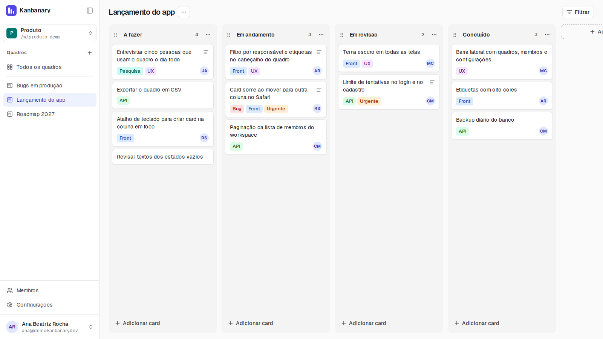
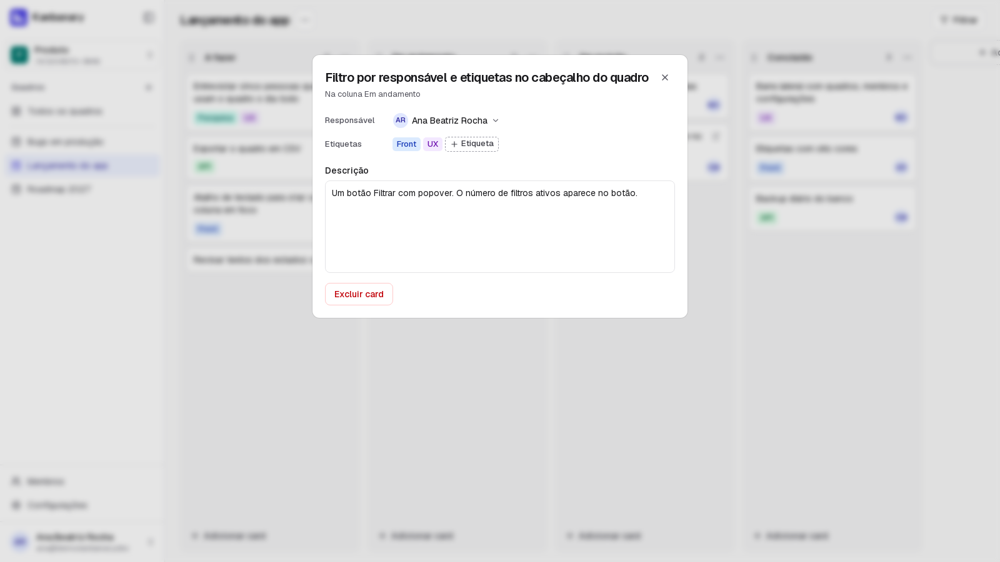
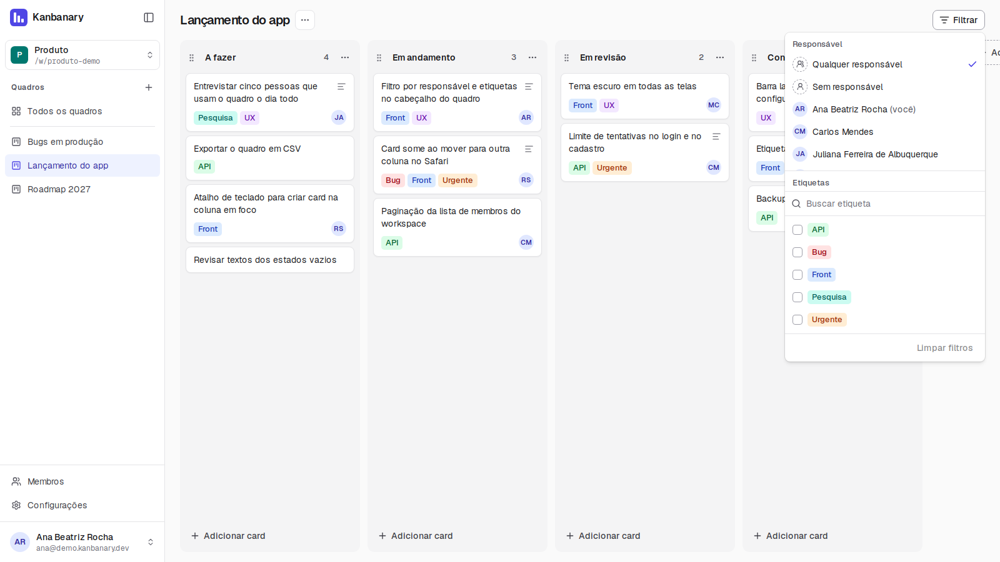
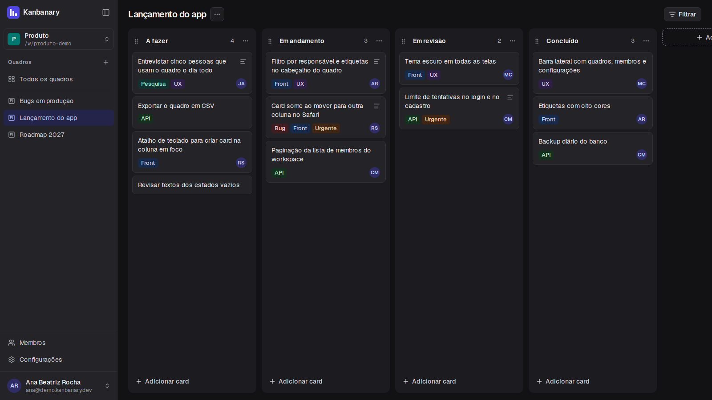
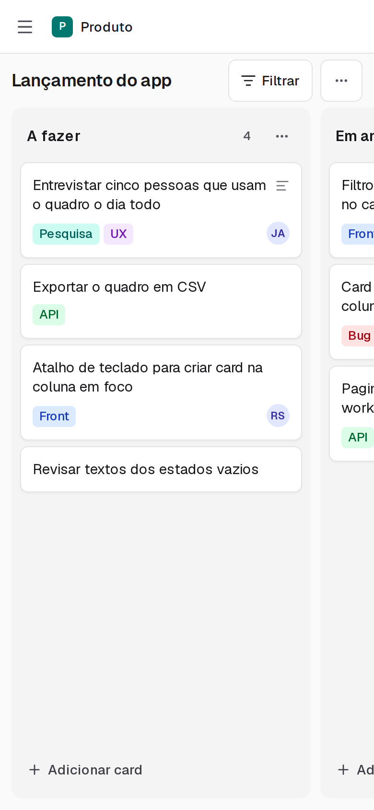

<p align="center">
  
</p>

<h1 align="center">Kanbanary</h1>

<p align="center">
  Kanban por workspaces para times pequenos: quadros, colunas e cards com arrastar e soltar.
</p>

<p align="center">
  <a href="https://kanban.joaodevdude.com"></a>
  <a href="https://github.com/joaosoarees/kanban/actions/workflows/ci.yml"></a>
  <a href="LICENSE"></a>
</p>

<p align="center">
  
</p>

O time entra num workspace, abre um quadro e move cards entre colunas ao longo do dia. Kanbanary faz só isso, sem plano pago e sem recurso que atrapalhe: cada card mostra quem está com ele e do que se trata, e o quadro cabe aberto o dia todo numa aba.

**Experimente em [kanban.joaodevdude.com](https://kanban.joaodevdude.com)**: o cadastro é aberto, só pede nome, e-mail e senha.

## O que faz

<table>
  <tr>
    <td width="50%" valign="top">
      <h3>Workspaces com papéis</h3>
      <p>Cada time tem seu workspace, com Dono, Admin e Membro. Quem administra adiciona as pessoas que já têm conta, e cada página confere o papel antes de mostrar qualquer coisa.</p>
      <h3>Arrastar sem esperar</h3>
      <p>Cards e colunas mudam de lugar na hora, antes de o servidor confirmar. Se a gravação falhar, o movimento volta e uma mensagem diz o que aconteceu. Pelo teclado e no celular, o mesmo movimento fica num menu.</p>
    </td>
    <td width="50%">
      
    </td>
  </tr>
  <tr>
    <td width="50%">
      
    </td>
    <td width="50%" valign="top">
      <h3>Responsável, etiquetas e filtros</h3>
      <p>Cada card tem um responsável e até quantas etiquetas precisar, em oito cores. Um botão Filtrar mostra só os cards de uma pessoa ou de uma etiqueta, e o filtro fica na URL para ser compartilhado.</p>
      <h3>Claro, escuro ou do sistema</h3>
      <p>O tema segue o sistema operacional ou fica fixo, e cada cor da interface tem um papel definido nos dois temas.</p>
    </td>
  </tr>
</table>

<p>
  
  
</p>

## Como é feito

Next.js 16 com App Router, React 19, TypeScript, Prisma 7 e PostgreSQL 18, com Tailwind CSS 4 e componentes shadcn sobre Base UI.

- **Sem camadas que o código não pede.** Server Components e Server Actions usam o Prisma direto. Erros esperados voltam como resultado da action; acesso negado vira 404.
- **Ordem sem renumerar.** A posição de colunas e cards usa índices fracionários, então mover um card grava uma linha só. É a única lógica com teste unitário, porque é a única que não é óbvia.
- **Desenhado antes de codado.** Cada tela passou por uma lista de estados e por pranchas aprovadas antes da implementação. O brief e as decisões de design estão em [DESIGN.md](DESIGN.md).
- **CI com orçamento de tempo.** Lint, formatação, typecheck, testes e build rodam em paralelo, e cada etapa falha se passar do tempo combinado. A `main` só recebe PR com o CI verde, por rebase, em commits pequenos.
- **Deploy a cada merge.** O CI chama o Coolify numa VPS, que builda uma imagem distroless e roda as migrations antes de subir a versão nova; o CI só fica verde quando o app no ar responde ao health check. O banco tem backup diário em S3, já testado com restauração. Os detalhes estão em [docs/DEPLOY.md](docs/DEPLOY.md).

O plano, o modelo de dados e as fatias de construção estão em [docs/PLAN.md](docs/PLAN.md).

## Rodando localmente

O app só precisa de Docker. Crie o `.env`:

```bash
cp .env.example .env
```

Preencha `SESSION_SECRET` e `EMAIL_CODE_SECRET` no `.env`, cada um com um resultado diferente de `openssl rand -base64 32`, e suba tudo:

```bash
docker compose up -d
```

O container instala as dependências, aplica as migrations e abre o app em <http://localhost:3000>. Ele usa o UID 1000, então seu usuário no host precisa ter esse UID.

Para ter um workspace pronto, com cinco pessoas, etiquetas e cards, rode o script de demonstração e entre com `ana@demo.kanbanary.dev` e a senha `demo-kanbanary`:

```bash
docker compose exec app bun scripts/seed-demo.ts
```

Depois de `git pull` ou de trocar de branch, reinicie para aplicar dependências e migrations novas:

```bash
docker compose restart app
```

Os hooks do git rodam dentro do container e são ativados na primeira subida, então suba antes do primeiro commit. Com o container desligado ou em uma git worktree, o commit é recusado. Se a subida falhar, o container fica ligado para você corrigir: veja o erro com `docker compose logs app`.

## Comandos

Rode cada um com `docker compose exec app` na frente.

| Comando                                                 | O que faz                                       |
| ------------------------------------------------------- | ----------------------------------------------- |
| `bun db:migrate --name <nome>`                          | cria e aplica migrations (`prisma migrate dev`) |
| `bun lint` / `bun check` / `bun test --isolate=modules` | checagens que o CI também roda                  |
| `bun fmt`                                               | formata tudo                                    |
| `bun scripts/seed-demo.ts`                              | recria o workspace de demonstração              |

O Prisma Studio roda fora do container e é o único comando que precisa de Node no host: `npx prisma studio`.

## Licença

[MIT](LICENSE)
